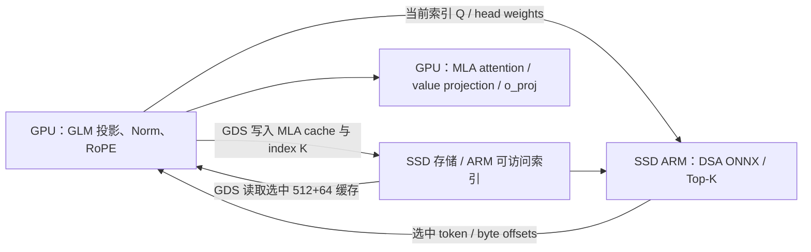

# GLM-5.3：计算型 SSD / GPU 直通缓存验证原型

已生成可执行 ONNX，验证 **DSA 选择 → 文件偏移 → 读取压缩缓存 → MLA latent context** 的数学与数据接口。当前验证在 x86 CPU 上使用随机张量和普通文件 I/O；不是完整 GLM 模型，不包含 checkpoint 权重，也没有实现或验证 GPUDirect Storage (GDS)。仓库源码没有修改。

## 建议先验证的方案

用户提供的 GLM-5.3 配置采用 MLA 与查询相关 DSA，建议保留原模型索引器，把 **DSA 分数计算与 Top-K 放在计算型 SSD 的 ARM 上**。SSD 侧有 ARM 是必要计算条件之一，但还需确认其可运行 Linux/ONNX Runtime、可访问本地缓存，以及设备固件和驱动支持 GDS 读写路径；不能仅据 ARM 芯片推定支持。



这是目标结构。GDS 绕过的是 CPU 主存的数据中转，不意味着不需要 CPU 提交 I/O、驱动或同步。ONNX 不表达 NVMe DMA、cuFile 或 ARM/GPU 设备调度；这些由模型运行时和存储 SDK 实现。当前 `run_onnx.py` 使用 CPUExecutionProvider；在 ARM 上它只代表 ARM CPU 计算，不代表 SSD 控制器自动执行 ONNX。

## 主交付文件

| 文件 | 用途 |
| --- | --- |
| `glm53_dsa_select.onnx` | SSD ARM 侧：查询相关分数、掩码、Top-K、文件偏移 |
| `glm53_mla_read.onnx` | GPU 侧数学契约：选中压缩 KV 的 absorbed MLA 计算，输出 latent context |
| `glm53_dsa_inputs.npz` / `glm53_dsa_expected.npz` | 2053 个候选、Top-2048 的固定随机测试向量 |
| `run_onnx.py` | 仅依赖 NumPy/ONNX Runtime 的执行器，可用于 ARM 移植验证 |
| `build_glm.py` / `validate_glm.py` | 图生成、PyTorch 对照和文件读取验证 |
| `glm_validation.json` | 本机验证结果和未验证范围 |

ONNX opset 18 / IR 9，浮点接口为 FP32。标准算子，不包含未实现的自定义 I/O 算子。ONNX 没有磁盘副作用，不负责缓存追加、释放和 page table 管理。

### SSD ARM 侧 `glm53_dsa_select.onnx`

输入：

| 名称 | 类型和形状 | 含义 |
| --- | --- | --- |
| `index_query` | FP32 `[B,S,32,128]` | 原模型索引 Q 投影、interleaved RoPE **之后** |
| `index_key` | FP32 `[B,N,128]` | 历史索引 K，原模型投影、LayerNorm、RoPE **之后** |
| `head_weights` | FP32 `[B,S,32]` | `weights_proj(hidden_states)` 原始输出；图内乘 `32^-0.5` |
| `allowed` | BOOL `[B,S,N]` | 同时包含 padding、causal 和请求隔离限制 |
| `requested_k` | INT64 `[1]` | 正整数；图内取 `min(requested_k,2048,N)`，要求 N≥1 |
| `record_stride` | INT64 标量 | 每 token 存储记录跨度，必须与文件布局一致 |
| `base_offsets` | INT64 `[B,1,1]` | 当前层、请求在文件中的起始 byte offset |

公式：`score[b,s,t] = Σ_h (head_weights[b,s,h]/√32) × ReLU(dot(q[b,s,h], k[b,t])/√128)`，随后应用 mask 和 Top-K。

输出 `top_scores`, `slots`, `selected_valid`, `byte_offsets`，形状均为 `[B,S,K]`。连续逻辑槽对应 `offset = base + slot × stride`；无效槽的 slot/offset 为 -1，必须跳过 I/O。真实分页/环形缓存需外部地址映射，不能直接套用连续文件偏移。INT64 可覆盖大文件。

ONNX TopK 对同分优先较小候选索引，PyTorch topk 的同分顺序未保证，故同分边界可能与原 GPU 内核选择不同；这是确定性参考策略，不宣称 BF16/FP8 的原模型逐位等价。`index_key` 一次传入全部历史，仅为参考图；大上下文应分块评分，并在**同一 query**内合并各块 Top-K，避免巨大中间张量。

### GPU 侧 `glm53_mla_read.onnx`

输入 `latent[B,S,K,512]`、`rope_key[B,S,K,64]`、`query_absorbed[B,S,64,512]`、`query_rope[B,S,64,64]`、`selected_valid[B,S,K]`。

其中 `query_absorbed[h] = q_nope[h] @ W_k[h]`，`W_k[h]` 是 checkpoint `kv_b_proj` 中该 head 的 key 部分，形状 `[192,512]`；`query_rope` 已应用原模型的 RoPE。权重吸收在图外完成。计算 `(q_abs @ latent.T + q_rope @ rope_key.T) / √256`，masked softmax 后乘 latent。输出 `[B,S,64,512]` 的 `latent_context`，之后还必须经过该 head 的 `W_v[h].T` 和模型 `o_proj`，才能得到完整 attention 输出。此图不含 EdgeRock 的 null attention 槽；全无效行按显式约定返回 0。

只接受合法历史 token；mask 和 slot 对齐由调用方保证。该图使用配置的默认 RoPE 对应 attention scale，不涵盖另外改动的 YaRN 缩放。

## 与 EdgeRock 的关系

EdgeRock `IndependentGQAMemory._query_scores` 的 admission 分数为 `W_up × SiLU(W_down × normalized_hidden)`，在写入时决定固定容量 anchors；记忆 read 另用 query attention。GLM DSA 在每个 query 上对历史 index K 评分。两者语义不同。

附带 `admission_score.onnx`、`stable_select.onnx`、`memory_read.onnx` 和 `validate.py`，供比较 EdgeRock 方法。它们是独立的通用实验，不能直接作为 GLM checkpoint 的无损替代。若将 GLM 改成 EdgeRock 的写入打分，需要新增/训练 admission 与 memory 模块并验证模型质量。

GLM 配置有 `full` / `shared` 索引层：shared 层复用上一个 full 层的**索引结果**，不会共享各层 MLA latent 数据；必须按层读取对应缓存。当前 ONNX 是单次索引与单层读取契约，78 层调度由外部模型运行时负责。新 token 的 index K 与压缩 KV 都要先写入并对 ARM 可见，当前 token 的 mask 才能开放；GDS 完成事件、文件/块映射的一致性需设备 SDK 保证。

## 本机复现

```bash
cd /path/to/EdgeRock
.venv/bin/python experiments/ssd_rma/validate.py
.venv/bin/python experiments/ssd_rma/validate_glm.py
.venv/bin/python experiments/ssd_rma/run_onnx.py \
  --model experiments/ssd_rma/glm53_dsa_select.onnx \
  --inputs experiments/ssd_rma/glm53_dsa_inputs.npz \
  --outputs experiments/ssd_rma/arm_outputs.npz
```

在 ARM Linux 上安装设备支持的 NumPy/ONNX Runtime，复制 `run_onnx.py`、ONNX 和 NPZ 后执行相同相对路径命令。运行器不依赖 PyTorch；重新生成图需要 `onnx`，对照验证需要 PyTorch。当前已测工具版本记录在 `requirements-validation.txt`。ARM 架构、OS、可用内存和 Runtime wheel 支持尚未实测。

GLM 测试覆盖：实际 32×128 索引维度、64 个 attention heads、512+64 缓存、Top-2048、短序列 K 截断、causal mask、同分和全无效输入。文件模拟读取 4096-byte 对齐的 FP32 记录，payload 为 2304 bytes；生产 BF16 payload 为 1152 bytes。没有测量实际 SSD、绕过 OS page cache、GPU 或 GDS。文件模拟经过 CPU，不能用它的时间证明 SSD 方案提速。

## 必须测量的规模和性能

按用户配置、单请求、N=1,048,576、78 层、BF16 MLA/index cache 估算（不包括额外元数据、padding、量化 scale、并发、MTP 和模型权重）：

* 每 token 每层 compressed MLA = `(512+64)×2 = 1152 bytes`。
* 全历史 MLA 约 **87.75 GiB**，offload 能节省显存，但 SSD 容量仍随上下文增长。
* 每层每步读取 2048 个 compressed MLA，共 78 层，紧凑 payload 合计 **175.5 MiB/output token**。若每条记录各读 4 KiB，未合并且无缓存时可达 **624 MiB/token**；选择共享不会消除不同层的数据读取。
* 按用户给出的 21 个 full indexer，每步完整扫描 BF16 index K 约 **5.25 GiB/token**（每个 full 层 256 MiB）；即使索引常驻 SSD ARM DRAM，仍消耗本地内存带宽，若从 NAND 扫描还受存储带宽限制。FP32 参考图的输入体积加倍。
* 单 full 层、单 query 的完整 FP32 head-score 中间张量约 128 MiB；实际应分块或融合。并行/批处理需重新预算。

设备验证应比较 GPU resident baseline、SSD offload baseline 和 ARM selection+GDS；分别记录 ARM 扫描/Top-K、实际读取字节、I/O 大小和次数、GPU 等待时间、端到端 token/s、P50/P99、显存及 ARM 内存，并检查 GDS 实际路径/统计证明无 host-bounce fallback。需要真实长上下文模型输出与质量对比；仅对照随机张量不能证明保留 GLM 精度。

## 参考来源与限制

GLM 配置依据本次用户提供的 `zai-org/GLM-5.3` config。公式对照从 Hugging Face Transformers main 下载的 `modeling_glm_moe_dsa.reference.py` 中 `GlmMoeDsaIndexer` 和 `GlmMoeDsaAttention`，副本及 SHA256 已保留。main 源码不是 GLM checkpoint 自带版本；checkpoint 精确版本、权重、BF16/FP8 数值、GPU/ARM SDK 仍需后续核对。未经验证，不把这份原型称为完整 GLM-5.3 ONNX 导出或 GDS 实现。
